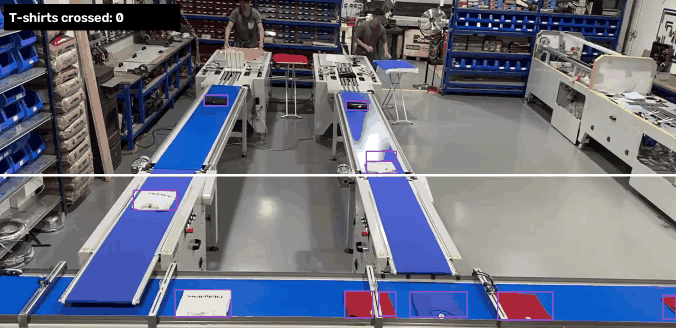

# T-Shirt Vision

YOLOv8 T-shirt detection and line crossing count for a conveyor video. The application runs on Windows 11 with Python 3.12, `uv`, and an NVIDIA RTX 4050. It writes crossing events to SQLite and logs each increment with Loguru.

## Demo



[Watch the full sample video](data/test.mp4). The white line marks the only location where a tracked T-shirt is counted. The application displays both the count for the current run and the database total across runs.

The accompanying annotations were exported from the [T-shirt Counts dataset on Roboflow](https://universe.roboflow.com/fabris-workspace-d46vz/t_shirt_counts/dataset/1), whose export declares a CC BY 4.0 license.

## Setup

```powershell
uv lock
uv sync --locked
uv run --locked python -c "import torch; print(torch.__version__, torch.cuda.is_available(), torch.cuda.get_device_name(0))"
```

The expected PyTorch build is `2.5.1+cu121`, and CUDA availability should be `True`. The NVIDIA driver can support a newer CUDA version than the runtime bundled with the PyTorch wheel.

## Run the counter

```powershell
uv run --locked python src/main.py
```

Press `q` in the video window to stop. Set the line's source-frame Y coordinate in `src/config.py`, or pass `--line-y`. To run without a window and use a separate database:

```powershell
uv run --locked python src/main.py --headless --db output/smoke_count.db
```

The trained weights are kept locally at `output/training/polera/weights/best.pt` and are not committed to Git. Reproduce them with the dataset and training commands below.

## Import and train

The Roboflow export uses segmentation polygons. The importer converts them to detection boxes and reserves the final video segment for validation:

```powershell
uv run --locked python src/import_roboflow.py
uv run --locked python src/train.py --check-only
uv run --locked python src/train.py --epochs 100 --imgsz 640 --batch 8
```

The dataset uses a single class, `0: polera`, matching the trained model. The previous 100-epoch run achieved precision 1.000, recall 0.979, mAP50 0.986, and mAP50-95 0.901 on seven reserved frames. These frames came from the same video, so the reported metrics do not measure performance on a new recording.

See the [project specification](specs/001-detector-tshirts.md) for acceptance criteria and remaining validation work.
